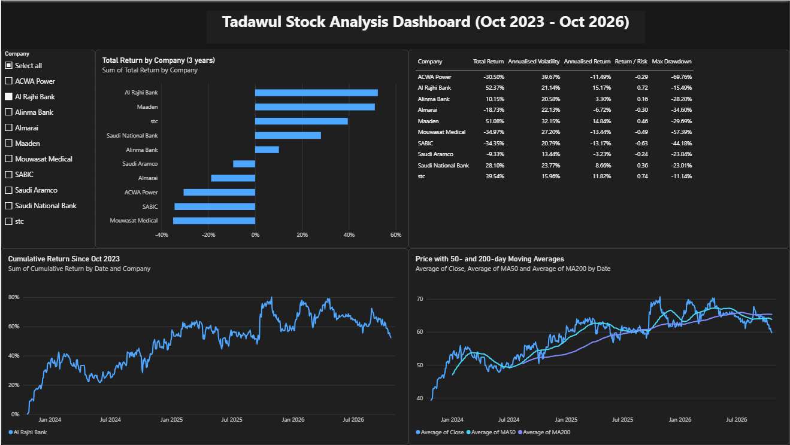

# Tadawul Stock Analysis Dashboard

An analysis of 10 large Saudi-listed companies over three years (26 Oct 2023 to 22 Oct 2026). Python downloads and processes the price data, and a Power BI dashboard presents returns, risk and trends.

**Tools:** Python (pandas, NumPy, yfinance, matplotlib), Google Colab, Power BI Desktop

## Companies analysed

Saudi Aramco, Al Rajhi Bank, Saudi National Bank, Alinma Bank, SABIC, Maaden, stc, Almarai, Mouwasat Medical and ACWA Power, covering banks, energy, materials, telecom, food, healthcare and utilities.

## What the project does

1. **Data:** downloads daily prices from Yahoo Finance with `yfinance` (Tadawul tickers end in `.SR`). Prices are adjusted for splits and dividends. 747 trading days per stock.
2. **Metrics (Python):**
   - daily return and cumulative return since the start date
   - 50-day and 200-day moving averages
   - 30-day rolling volatility (annualised, 252 trading days)
   - drawdown from the previous peak, and maximum drawdown
   - annualised return and volatility, and a simple return/risk ratio (risk-free rate assumed 0)
   - correlation matrix of daily returns
3. **Export:** three clean CSV tables (prices, summary, correlation).
4. **Dashboard (Power BI):** company slicer, total return bar chart, summary table, cumulative return chart and a price chart with moving averages.

## Key findings

| Company | Total return | Volatility | Return / risk | Max drawdown |
|---|---|---|---|---|
| Al Rajhi Bank | 52.4% | 21.1% | 0.72 | -15.5% |
| Maaden | 51.1% | 32.1% | 0.46 | -29.7% |
| stc | 39.5% | 16.0% | 0.74 | -11.1% |
| Saudi National Bank | 28.1% | 23.8% | 0.36 | -23.0% |
| Alinma Bank | 10.2% | 20.6% | 0.16 | -28.2% |
| Saudi Aramco | -9.3% | 13.4% | -0.24 | -23.8% |
| Almarai | -18.7% | 22.1% | -0.30 | -34.6% |
| ACWA Power | -30.5% | 39.7% | -0.29 | -69.8% |
| SABIC | -34.4% | 20.8% | -0.63 | -44.2% |
| Mouwasat Medical | -35.0% | 27.2% | -0.49 | -57.4% |

- Al Rajhi Bank and Maaden had similar total returns, but Maaden was much riskier (32% vs 21% volatility, and a drawdown twice as deep).
- stc had the best return for the risk taken (0.74), with the second-lowest volatility.
- ACWA Power rose to about +130% in late 2024 and then fell back below its starting price, giving the largest drawdown (-69.8%).
- The three banks (Al Rajhi, Alinma, Saudi National Bank) are the most correlated group, at about 0.6 to 0.7. Most other pairs sit around 0.2 to 0.3, so mixing sectors diversifies better than holding only banks.

## Files

- `tadawul_analysis.ipynb`: Colab notebook (data download, calculations, charts, export)
- `tadawul_dashboard.pbix`: Power BI report
- `tadawul_prices.csv`, `tadawul_summary.csv`, `tadawul_correlation.csv`: exported data
- `dashboard.png`: dashboard screenshot

## How to run

1. Open `tadawul_analysis.ipynb` in [Google Colab](https://colab.research.google.com) and run the cells in order.
2. Load the exported CSV files in Power BI Desktop, or open the included `.pbix` file.

## Limitations

- Only 10 stocks and one three-year period, so results describe this window and not the future.
- Returns are price-based from Yahoo Finance data and may differ slightly from official Tadawul figures.
- The return/risk ratio ignores the risk-free rate.
- This is a data analysis project and not investment advice.

## Author

Fajr Alhusaynan - Data Science student, Prince Musaid bin Abdulrahman University
[LinkedIn](https://linkedin.com/in/fajralhysanan) | [GitHub](https://github.com/fajrraed)
